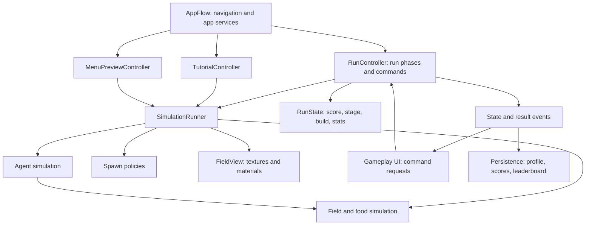

# Microverse architecture review

Reviewed 9 October 2026. Scope: all 24 authored C# scripts under Assets, the shared SardineManager prefab, and relevant wiring/overrides in Main, Tutorial, and GamePlay scenes. This is a static source review, not a Unity playtest or profiler measurement. No game scripts or scenes were changed.

## Main finding

There is no explicit owner of a game run. Simulation components, UI, and scene-specific scripts each make part of the rules. This makes it difficult to add stages, rewards, upgrades, a shop, run resets, or persistent unlocks without adding more unrelated conditions to the existing managers.

Reusing the simulation for a tutorial or an animated menu is sensible. The coupling problem is the authority to mutate rules, schedule simulation, decide defeat, and persist progress being spread across unrelated components.

## Highest-priority changes

### 1. Give a run one lifecycle owner

Evidence: [Assets/GameplayManager.cs](<C:/utility/University/UAL GAME DEV CLONE/Microverse02/Microverse02/Microverse02/Assets/GameplayManager.cs:5>) is empty. [Assets/Scripts/Not Main/GameOverUI.cs](<C:/utility/University/UAL GAME DEV CLONE/Microverse02/Microverse02/Microverse02/Assets/Scripts/Not Main/GameOverUI.cs:26>) decides defeat and its TriggerGameOver saves results and sets global time. [Assets/Scripts/Not Main/PauseMenuUI.cs](<C:/utility/University/UAL GAME DEV CLONE/Microverse02/Microverse02/Microverse02/Assets/Scripts/Not Main/PauseMenuUI.cs:33>) independently changes global time without checking whether the run ended.

Create a RunController that owns phase transitions and a RunState holding score, stage, run seed/random state, currency, owned upgrades, and computed stats. Its job is orchestration, not implementing movement, diffusion, UI, and save files.

Suggested phases: Preparing, Playing, ChoosingReward, Results. Track pause separately from phase, so Resume returns to the correct phase and cannot resume Results. Add Shop only when a shop mechanic is actually implemented.

RunController accepts commands such as StartRun, RequestPause, ChooseReward, ContinueStage, and EndRun. UI requests changes and observes state. It does not decide whether the run is valid or ended.

### 2. Separate authored definitions, current run state, and persistent profile

Evidence: balance values live in [Assets/Scripts/Main/SardineManager.cs](<C:/utility/University/UAL GAME DEV CLONE/Microverse02/Microverse02/Microverse02/Assets/Scripts/Main/SardineManager.cs:12>) and [Assets/Scripts/Main/OceanFieldManager.cs](<C:/utility/University/UAL GAME DEV CLONE/Microverse02/Microverse02/Microverse02/Assets/Scripts/Main/OceanFieldManager.cs:22>); current score is held by the field at line 19; difficulty reads that score directly at SardineManager lines 121 and 537.

Use ScriptableObject assets for definitions such as SimulationConfig, AgentDefinition, StageDefinition, and UpgradeDefinition. Use ordinary runtime objects for RunState, UpgradeInstance, and calculated AgentStats. Use a separate ProfileStore for saved unlocks/settings/high scores. Do not mutate shared definition assets when selecting an upgrade.

Example: an upgrade adds a player speed modifier to RunState; a stats calculator combines base speed and active modifiers; the agent simulation consumes the resulting stats. It should not need to know the upgrade's title or which reward UI selected it.

Specify stacking and evaluation order explicitly: additive bonuses, multiplicative bonuses, then limits. Later introduce event-triggered effects only when content requires them. Do not put every upgrade's conditional behavior in ApplyBacteriaFieldSteering.

Unity documents ScriptableObjects as reusable asset data containers and distinguishes authored assets from saving runtime data in deployed builds: [ScriptableObject manual](https://docs.unity3d.com/2022.3/Documentation/Manual/class-ScriptableObject.html).

### 3. Give simulation scheduling and presentation separate owners

Evidence: [Assets/Scripts/Main/SardineManager.cs](<C:/utility/University/UAL GAME DEV CLONE/Microverse02/Microverse02/Microverse02/Assets/Scripts/Main/SardineManager.cs:110>) deposits trails once per rendered frame, asks OceanFieldManager to run accumulated field ticks, and triggers its texture upload. [Assets/Scripts/Not Main/MenuVisual.cs](<C:/utility/University/UAL GAME DEV CLONE/Microverse02/Microverse02/Microverse02/Assets/Scripts/Not Main/MenuVisual.cs:75>) independently uploads textures every second frame in Main.

Introduce a SimulationRunner with an explicit Step(dt). Initially it can coordinate the existing managers rather than rewriting their algorithms. Give food, movement, lifetime, trail deposition, diffusion, and interaction processing defined timing and ordering. Decide whether deposits are amounts per second or per distance and express the units accordingly.

OceanFieldView generates/uploads textures after simulation has advanced, at its own presentation cadence. It owns colors/materials and manages their lifecycle. A slower display should not change the rules of the run.

Current diffusion uses drawDiffuseRate as a per-tick lerp coefficient at OceanFieldManager line 655, whereas decay is scaled by dt at line 527. Therefore increasing tick frequency increases the amount of diffusion per game second unless retuned or converted to a rate. The currently inspected code has a private, non-serialized 1/120 interval at line 49; old prefab/scene serialized values are stale for this field.

### 4. Give menu preview and tutorial separate policies

Evidence: [Assets/Scripts/Main/SardineManager.cs](<C:/utility/University/UAL GAME DEV CLONE/Microverse02/Microverse02/Microverse02/Assets/Scripts/Main/SardineManager.cs:412>) branches on isMainMenu to change enemy food consumption/reproduction. [Assets/Scripts/Not Main/MenuVisual.cs](<C:/utility/University/UAL GAME DEV CLONE/Microverse02/Microverse02/Microverse02/Assets/Scripts/Not Main/MenuVisual.cs:73>) changes SensorDistance, which is an actual steering parameter. [Assets/Scripts/Not Main/TutorialManager.cs](<C:/utility/University/UAL GAME DEV CLONE/Microverse02/Microverse02/Microverse02/Assets/Scripts/Not Main/TutorialManager.cs:118>) controls player spawning and reproduction permission through playerSpawnStart.

Keep one reusable simulation. Instantiate/configure it separately in each scene:

- MenuPreviewController configures a decorative simulation, does not create a player run, and does not save scores.
- TutorialController configures lesson scenarios and requests actions such as SpawnPlayer or SpawnFoodCluster. It observes actual drawing/food events.
- RunController configures playable stages and owns progression/rewards/results.

Replace misleading permission flags with explicit settings: spawn an initial player, allow reproduction, allow enemy spawning, grant score for food. Avoid tutorial-specific method names in reusable systems: SpawnFoodCluster is useful in any scenario; SpawnTutorialCluster is a wrapper with no special behavior.

### 5. Keep simulation outcomes separate from score and presentation

Evidence: [Assets/Scripts/Main/OceanFieldManager.cs](<C:/utility/University/UAL GAME DEV CLONE/Microverse02/Microverse02/Microverse02/Assets/Scripts/Main/OceanFieldManager.cs:308>) both removes food and awards score. Its bool return loses how much food was eaten. [Assets/Scripts/Main/SardineManager.cs](<C:/utility/University/UAL GAME DEV CLONE/Microverse02/Microverse02/Microverse02/Assets/Scripts/Main/SardineManager.cs:591>) exposes a food-eaten flag that reading resets.

Return a FoodConsumptionResult (agent/team, cells consumed, units consumed, position) or emit a gameplay event after committing the interaction. Run scoring, upgrades, tutorial conditions, sound, and UI can each observe the result. Define whether score counts occupied cells or food units; current code clears a cell containing multiple units but adds one point.

Use ordinary C# events for occasional outcomes and UI updates. Keep per-agent field sampling and movement as direct calls/data operations; emitting events for every grid cell would add noise and overhead.

## Behavioral issues to address during the refactor

These findings follow from current source. They should be reproduced in Play mode before treating them as runtime-tested bugs.

| Priority | Finding | Consequence and fix |
|---|---|---|
| High | SardineManager.Update runs deposition and steering/feeding even when dt is zero. PlanktonManager.Update can replenish without elapsed time. | Pausing global time does not gate these discrete gameplay changes. Only advance simulation when its owning session permits it. Keep UI animation separate. |
| High | PauseMenuUI can set timeScale to 1 after GameOverUI set it to 0; GameOverUI's isGameOver then prevents another defeat check. | Esc/Resume can resume an ended simulation. Enforce transitions in RunController and reject resume from Results. |
| High | Trail deposits are amounts per rendered frame; diffusion is an amount per field tick. | FPS/tick settings can change trail strength and behavior. Define simulation rates, tick order, and units before balancing content. |
| Medium | SardineManager creates/reuses agents while iterating the same list in ApplyBacteriaFieldSteering. | Newborns can be processed this frame or next depending on append/reused-slot position. Queue births/deaths and commit them at an explicit point. |
| Medium | TutorialManager.Start disables playerSpawnStart after SardineManager.Awake may already have spawned a player. | Current Tutorial overrides playerSpawnStart to false, so it is protected by scene setup. Future configuration errors can spawn too early. Configure before explicit StartSimulation; do not rely on Start undoing Awake. |
| Medium | OceanFieldManager allocates textures and accesses renderer.material but does not explicitly destroy owned textures/material instances. OnDisable unbinds textures without an OnEnable rebinding path. | Repeated sessions and disable/re-enable require deliberate resource ownership. FieldView should destroy only its owned resources and rebind appropriately. |
| Medium | Prefab retains old property names (SardineFieldManager, bacteriaFieldManager, cursorCircle); scenes also contain new-name overrides. | Current scenes can conceal an incomplete base prefab. Verify a fresh instance and migrate serialized fields deliberately. Preserve .meta GUIDs. |
| Medium | HighScoreManager clears scores on a hard-coded version mismatch. | A build release can delete retained scores; a progression system would need save-schema migrations rather than build-based wiping. |
| Medium | Food totals are recomputed by scanning the grid every frame; live agent counts are repeatedly scanned inside birth handling. | Avoidable work grows with grid/population size. Maintain totals/counters when adding/removing entities, after lifecycle rules are clear. |
| Medium | LeaderboardUI assumes a singleton exists and can label unfinished initialization Offline. No score submission caller was found. | Make initialization/submission explicit and handle async view lifetime and retries. This integration is not a completed run-result pipeline. |
| Low | Unused members and dormant mechanics remain in the Inspector/source. | sardineCount does not spawn agents; wander settings, lastEnemySpawnStep, foodTickCounter, and RunPlanktonMove are unused in inspected C#. Energy consumption is commented out. Confirm scene/event references before removal. |

Unity's lifecycle reference confirms Awake precedes Start and Update runs per frame: [execution order](https://docs.unity3d.com/2022.3/Documentation/Manual/ExecutionOrder.html). When renaming serialized fields, use an intentional migration, such as [FormerlySerializedAs](https://docs.unity3d.com/2022.3/Documentation/ScriptReference/Serialization.FormerlySerializedAsAttribute.html), and verify prefab/scene references afterward.

## Proposed responsibilities and dependency direction



These are responsibility boundaries, not a demand for a separate class for every box immediately. Begin with RunController/RunState and one SimulationRunner coordinating the existing managers. Avoid a global event bus or making all managers singletons. Serialize references in one scene setup component and pass dependencies explicitly where useful.

Keep packed agent data and pooled slots. Organizing responsibilities does not require a GameObject/MonoBehaviour per sardine. Once CPU logic and rendering are separated, a future GPU backend becomes easier to evaluate.

## Suggested folders

Create these under Assets/Scripts, moving script assets together with their .meta files:

```text
App/                 AppFlow, scene transition coordination, app setup
Runs/                RunController, RunState, RunResult, score and stage rules
Simulation/Agents/   agent state, movement, steering, interaction processing
Simulation/Fields/   field state and jobs
Simulation/Spawning/ food/enemy spawn policies
World/               MapManager and map data
Content/             configuration and upgrade/stage definition types
Input/               drawing commands and pointer mapping
Presentation/        field view, audio, visual effects
UI/                  menu, HUD, pause, results, tutorial, common widgets
Tutorial/            tutorial director and lesson conditions
Persistence/         profile/high scores/leaderboard services
Diagnostics/         FPSCounter
Editor/              map editor tools
```

Keep definition assets under Assets/GameData (for example Upgrades and Stages). Folder moves improve navigation but do not enforce dependency boundaries. Consider assembly definitions later only when responsibilities settle. Preserve serialized type/method references when renaming classes or UnityEvent callbacks.

## Review of every authored script

| Script | Current assessment | Recommended home/change |
|---|---|---|
| [Assets/GameplayManager.cs](<C:/utility/University/UAL GAME DEV CLONE/Microverse02/Microverse02/Microverse02/Assets/GameplayManager.cs:5>) | Empty controller; no scene references found by script GUID. | Replace or repurpose as RunController after defining its lifecycle responsibilities. |
| [Assets/Scripts/Main/SardineManager.cs](<C:/utility/University/UAL GAME DEV CLONE/Microverse02/Microverse02/Microverse02/Assets/Scripts/Main/SardineManager.cs:110>) | Owns field ticking/render refresh, spawning, difficulty, movement, feeding, death, pooling, and tutorial flags. | First remove clock, scoring dependencies, and run/mode decisions. Keep the packed agent data and pooling. Split spawning and interactions only as needed. |
| [Assets/Scripts/Main/OceanFieldManager.cs](<C:/utility/University/UAL GAME DEV CLONE/Microverse02/Microverse02/Microverse02/Assets/Scripts/Main/OceanFieldManager.cs:308>) | Combines field/food storage, score, sensing configuration, jobs, textures, and renderer lifecycle. | Move score to run rules and texture/material work to OceanFieldView. Expose field operations through a small explicit API. |
| [Assets/PlanktonManager.cs](<C:/utility/University/UAL GAME DEV CLONE/Microverse02/Microverse02/Microverse02/Assets/PlanktonManager.cs:32>) | Controls initial spawn and continuous replenishment; scans the entire food grid each frame. | Make a FoodSpawner configured per mode/stage. Track food totals when adding/removing food. |
| [Assets/MapManager.cs](<C:/utility/University/UAL GAME DEV CLONE/Microverse02/Microverse02/Microverse02/Assets/MapManager.cs:55>) | Useful map/grid boundary component. WorldToCell clamps all positions, so IsWallWorld's later bounds check cannot reject out-of-map positions. | Keep as World/Map. Distinguish TryWorldToCell from a deliberately clamped conversion. Recompute aspect during initialization as well as validation. |
| [Assets/Editor/MapManagerEditor.cs](<C:/utility/University/UAL GAME DEV CLONE/Microverse02/Microverse02/Microverse02/Assets/Editor/MapManagerEditor.cs:7>) | Custom inspector only calls DrawDefaultInspector. | Keep under Editor only if custom map tooling is planned; otherwise redundant. |
| [Assets/Scripts/Not Main/TutorialManager.cs](<C:/utility/University/UAL GAME DEV CLONE/Microverse02/Microverse02/Microverse02/Assets/Scripts/Not Main/TutorialManager.cs:93>) | Owns tutorial steps, UI, polling, spawn toggles, and scene navigation. | Keep a tutorial director, reuse the simulation through commands and events, and move text/visual presentation to a tutorial view when useful. |
| [Assets/Scripts/Not Main/MenuVisual.cs](<C:/utility/University/UAL GAME DEV CLONE/Microverse02/Microverse02/Microverse02/Assets/Scripts/Not Main/MenuVisual.cs:54>) | Changes field colors, gameplay sensor distance, and directly rebuilds textures. | Separate MenuPreviewController settings from field appearance. Let the shared renderer own texture refresh. |
| [Assets/Scripts/Not Main/MainMenuUI.cs](<C:/utility/University/UAL GAME DEV CLONE/Microverse02/Microverse02/Microverse02/Assets/Scripts/Not Main/MainMenuUI.cs:26>) | Primarily panel presentation and scene-navigation requests; it does not directly control sardine simulation. | Mostly keep. Route start/tutorial requests through AppFlow and prevent repeated transitions. |
| [Assets/Scripts/Not Main/GameOverUI.cs](<C:/utility/University/UAL GAME DEV CLONE/Microverse02/Microverse02/Microverse02/Assets/Scripts/Not Main/GameOverUI.cs:26>) | Decides defeat, reads score, saves results, controls music, and freezes global time. | RunController decides defeat and produces RunResult. Results UI displays it; persistence receives it separately. |
| [Assets/Scripts/Not Main/PauseMenuUI.cs](<C:/utility/University/UAL GAME DEV CLONE/Microverse02/Microverse02/Microverse02/Assets/Scripts/Not Main/PauseMenuUI.cs:33>) | Owns independent pause state and global time; can resume time after GameOverUI has ended the run. | Request pause/resume/restart from the run/app controllers; present their authoritative state. |
| [Assets/Scripts/Not Main/UIManager.cs](<C:/utility/University/UAL GAME DEV CLONE/Microverse02/Microverse02/Microverse02/Assets/Scripts/Not Main/UIManager.cs:43>) | Score-only HUD tied to OceanFieldManager; leftover timer/energy fields. | Rename to GameplayHud, read RunState, update on score changes, remove genuinely unused state after reference checks. |
| [Assets/Scripts/Not Main/ChenimalDraw.cs](<C:/utility/University/UAL GAME DEV CLONE/Microverse02/Microverse02/Microverse02/Assets/Scripts/Not Main/ChenimalDraw.cs:54>) | Combines mouse input, cursor, field modification, map queries, sound, and commented energy logic. | First isolate drawing commands from presentation. Share pointer-to-world mapping; use run input permissions; support touch intentionally. |
| [Assets/Scripts/Not Main/PlayerEnergy.cs](<C:/utility/University/UAL GAME DEV CLONE/Microverse02/Microverse02/Microverse02/Assets/Scripts/Not Main/PlayerEnergy.cs:12>) | Small energy model, but integration in ChenimalDraw is commented out. | Keep only if the mechanic is planned. Place current energy in run-owned runtime state if upgrades affect it. |
| [Assets/Scripts/Not Main/ScreenFader.cs](<C:/utility/University/UAL GAME DEV CLONE/Microverse02/Microverse02/Microverse02/Assets/Scripts/Not Main/ScreenFader.cs:48>) | Owns both visual fades and scene loading. | Keep fades as presentation; AppFlow coordinates one transition at a time and calls SceneManager. |
| [Assets/Scripts/Not Main/MenuCursor.cs](<C:/utility/University/UAL GAME DEV CLONE/Microverse02/Microverse02/Microverse02/Assets/Scripts/Not Main/MenuCursor.cs:15>) | Duplicates camera conversion and map clamping from ChenimalDraw, with different hard-coded margins. | Share a small pointer mapper if the same interaction is intended; keep cursor styling local. |
| [Assets/Scripts/Not Main/HighScoreManager.cs](<C:/utility/University/UAL GAME DEV CLONE/Microverse02/Microverse02/Microverse02/Assets/Scripts/Not Main/HighScoreManager.cs:12>) | Keeps local scores, clears them when the hard-coded build/save version changes. | Extract a ScoreStore/ProfileStore. Version save schemas separately from app builds and migrate retained data. |
| [Assets/Scripts/Not Main/LeaderBoard/UGSLeaderboardManager.cs](<C:/utility/University/UAL GAME DEV CLONE/Microverse02/Microverse02/Microverse02/Assets/Scripts/Not Main/LeaderBoard/UGSLeaderboardManager.cs:16>) | Existing persistence/service boundary with a persistent singleton; readiness and failures are handled internally. | Keep service separate from gameplay; expose initialization completion and explicit submission outcomes. No SubmitScore caller was found in authored C# or serialized UI method names. |
| [Assets/Scripts/Not Main/LeaderBoard/LeaderboardUI.cs](<C:/utility/University/UAL GAME DEV CLONE/Microverse02/Microverse02/Microverse02/Assets/Scripts/Not Main/LeaderBoard/LeaderboardUI.cs:13>) | Direct singleton access, asynchronous updates without lifetime checks, and no readiness retry. | Wait for service readiness, distinguish loading/offline/error, and ignore stale requests after view destruction or replacement. |
| [Assets/Scripts/Not Main/LeaderBoard/NameInputFilter.cs](<C:/utility/University/UAL GAME DEV CLONE/Microverse02/Microverse02/Microverse02/Assets/Scripts/Not Main/LeaderBoard/NameInputFilter.cs:14>) | UI input sanitation and banned strings. | Keep under UI/Leaderboard; add listener cleanup and validate assigned input field. No name submission implementation was found. |
| [Assets/Scripts/Not Main/ButtonTextHover.cs](<C:/utility/University/UAL GAME DEV CLONE/Microverse02/Microverse02/Microverse02/Assets/Scripts/Not Main/ButtonTextHover.cs:17>) | Focused hover presentation. | Keep under UI/Common. Low priority; no need to rewrite. |
| [Assets/Scripts/Not Main/UIButtonSound.cs](<C:/utility/University/UAL GAME DEV CLONE/Microverse02/Microverse02/Microverse02/Assets/Scripts/Not Main/UIButtonSound.cs:8>) | Focused button audio. | Keep under UI/Common or Presentation/Audio. Low priority. |
| [Assets/Scripts/Not Main/TitleImageEffect.cs](<C:/utility/University/UAL GAME DEV CLONE/Microverse02/Microverse02/Microverse02/Assets/Scripts/Not Main/TitleImageEffect.cs:26>) | Focused title animation using unscaled time. | Keep under Presentation. Validate required title references. |
| [Assets/Scripts/Not Main/FPSCounter.cs](<C:/utility/University/UAL GAME DEV CLONE/Microverse02/Microverse02/Microverse02/Assets/Scripts/Not Main/FPSCounter.cs:15>) | Development FPS overlay. | Keep under Diagnostics and optionally gate it in release builds. |

## Incremental implementation order

1. Establish a baseline: Main preview, tutorial completion/skip, gameplay, pause, defeat, restart, scores. Record scene and prefab values that are intentional.
2. Add RunState and a small RunController. Move score ownership and game-over/pause decisions there. Wire current HUD/results/pause buttons to it. Gate discrete simulation mutation when paused/ended.
3. Introduce explicit simulation initialization and Step(dt). Move tick scheduling out of SardineManager; document update ordering, deposit units, birth/death commit timing, and rendering cadence.
4. Extract FieldView and mode configuration. Remove the menu's direct texture scheduling; replace menu/tutorial branches with policies/configuration at setup.
5. Introduce authored stage/upgrade definitions plus computed runtime stats. Separate profile persistence and run reset. Keep the existing game playable throughout.
6. Build one complete replayable slice: stage objective -> choose one of three upgrades -> next stage -> defeat/victory -> new run with fresh run state. Add a shop or permanent unlocks only after that works.
7. Profile the organized simulation on target devices. Optimize counters/jobs and assess GPU conversion from measured costs.

An example original upgrade set could trade faster player movement, longer lifetime, or stronger drawing against reduced reproduction, faster decay, or increased enemy pressure. The architectural requirement is that rewards change a run's build in one defined place and later stages consume that build. Do not scatter upgrade-specific branches into UI, field jobs, and the agent loop.

## Verification targets for implementation

- Pause: wait several real seconds; positions, food, score, population, and lifetimes remain unchanged.
- Results: Esc/Resume cannot revive simulation; final score is saved/submitted at most once.
- New run: stage, currency, modifiers, score, timers, agents, fields, and run RNG reset; profile unlocks remain.
- Next stage: run build/currency persist while stage-specific world state resets.
- Tutorial/menu: no score persistence or reward progression; their scenario setup is explicit.
- Clock: compare equivalent recorded input at different render rates; gameplay outcomes should not depend on presentation cadence beyond documented numerical tolerances.
- Tick rate: decay/diffusion rates have clear units and preserve intended behavior when frequency changes.
- Modifier stacking: selected upgrades apply once, combine in the specified order, and disappear on a fresh run.
- Resources: repeated restart and enable/disable do not leak owned textures/materials or leave the field blank.
- Scene/prefab wiring: a fresh prefab instance has valid references; script GUIDs and UnityEvent callbacks remain valid.

